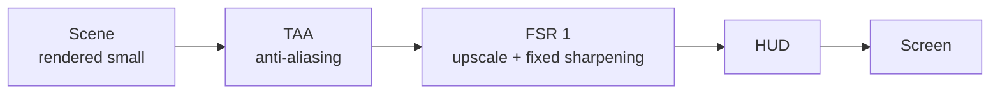
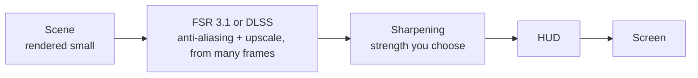
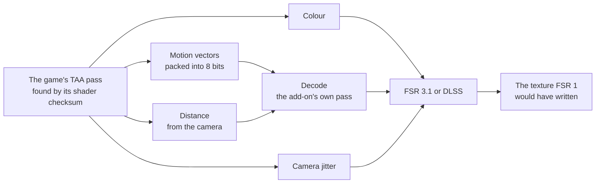
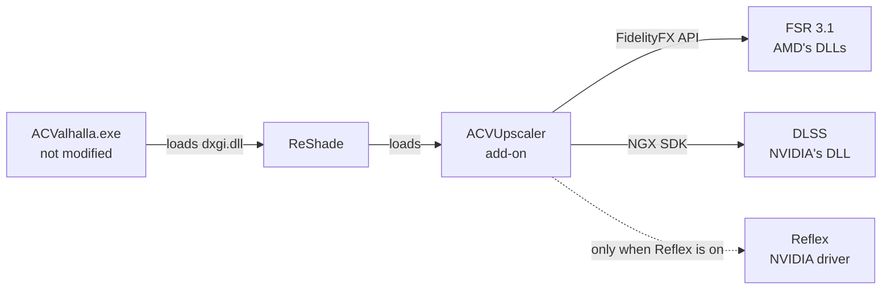
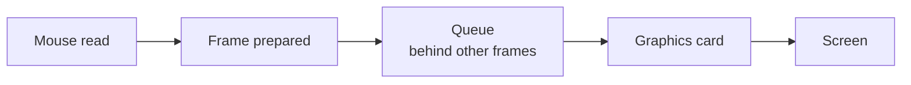
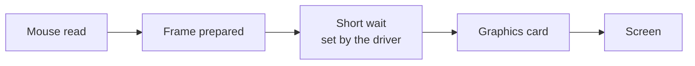
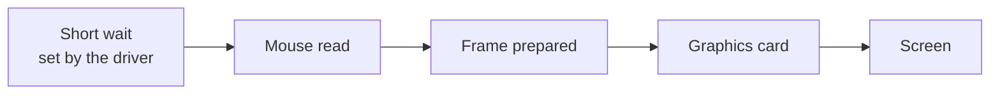

# ACVUpscaler

Replaces the anti-aliasing and the FSR 1 upscale of **Assassin's Creed Valhalla** (PC, DirectX 12) with
**FSR 3.1**, or with **DLSS** on NVIDIA RTX cards, and adds **NVIDIA Reflex** low latency in a limited form.

> **Beta.** Tested on one PC: Steam version of the game as of November 2026, RTX 3060, 2560x1440, Windows 11.
> Single-player only, at your own risk.

Comparison video (4K, watch at 2160p): https://www.youtube.com/watch?v=j24VcwrQKlU
Recorded with 1.0.0-beta.1: unless a label says otherwise, every upscaled setting has the game's fixed sharpening
pass on top, which leaves DLSS and FSR 3.1 sharper than FSR 1. Since beta.2 the strength can be set.

## What it does

The game anti-aliases and upscales in two separate steps, and its upscaler (FSR 1) sees one frame at a time.
The mod takes both steps out and puts one temporal upscaler in their place.

The game alone:

With ACVUpscaler:

## Install

1. Download `ACVUpscaler-<version>.zip` from the Releases page and extract it outside the game folder.
2. Close the game and run `ACVUpscalerSetup.exe`.
3. Choose the upscaler and the render quality, press **Install / Apply**. The tool lists every file before it
   adds it.
4. Start the game. To check: **Home** key, **Add-ons** tab, `Status: active`.

To remove it, run the tool again and press **Uninstall**. Details: [INSTALL.md](INSTALL.md),
[UNINSTALL.md](UNINSTALL.md).

## How it works

**Every frame.** The game already makes what a temporal upscaler needs, for its own TAA. The add-on takes
those inputs, decodes two of them, and writes the result where the game expects its FSR 1 output.

**Loading.** Nothing of the game is modified. The game loads ReShade under a standard DLL name, ReShade loads
the add-on, and the add-on calls the upscaler itself. Where DLSS cannot start, FSR 3.1 does the work.

## Reflex: reducing latency

When the graphics card is the limit, finished frames queue up in front of it. Reflex lets the driver make the
game wait instead, so frames stop piling up. Where that wait sits decides how fresh the mouse input is.

The stock game: no Reflex, frames queue.

ACVUpscaler: the queue is gone. The wait sits where an add-on can reach, between two frames, and not before
the mouse is read.

A game with Reflex built in: the wait comes first, so the mouse is read as late as possible.

| | Stock game | ACVUpscaler | Reflex built into a game |
|---|---|---|---|
| Frames queue in front of the card | yes | no | no |
| Place of the wait | none | between two frames | before the mouse is read |
| Needs changes inside the game | no | no | yes |
| Frame start to finished frame, measured | 38 ms | 20 ms | not possible in this game |

- Measured in the game's benchmark (DLSS K, Balanced, RTX 3060), at the same frame rate with and without. The
  lowest 1 % came out 2 to 4 fps higher with Reflex, in three pairs of runs. The time from the mouse to the game
  and the display are not in these numbers.
- Off by default. Switch it on in the setup tool, or in the add-on's panel in the game (**Home** key,
  **Add-ons** tab), where it takes effect at once. NVIDIA cards only.

## Method: how FSR 3.1 and DLSS got into the game

1. **The idea.** Valhalla ships only FSR 1, which sees one frame at a time. For its own TAA the game already
   produces what a temporal upscaler needs: motion vectors, depth and a jittered camera. The task was to find
   them and hand them to a modern upscaler.
2. **Finding the inputs.** Frame captures showed the TAA pass, the two FSR 1 passes, and the textures and
   constants they read.
3. **Decoding them.** The motion vectors are packed into an 8-bit texture, the "depth" is distance from the
   camera, the jitter sits in the TAA's constants. Each one was decoded and then verified with dumps made from
   inside the running game, never assumed.
4. **Proof at native resolution.** FSR 3.1 first replaced only the game's TAA, with no upscaling. A stable,
   sharp picture there proved the inputs right.
5. **Upscaling.** With FSR 1 on, the game renders at a lower resolution and upscales at the end of the frame.
   The add-on recognises those passes by the checksums of their shaders, skips them and runs FSR 3.1 in their
   place, writing into the texture the game expects.
6. **DLSS.** Up to beta.2 the add-on only spoke AMD's FSR 3.1 API, and
   [OptiScaler](https://github.com/optiscaler/OptiScaler) turned those calls into DLSS. Now the add-on calls
   DLSS itself through NVIDIA's SDK, with the same inputs. On a recorded sequence of frames the two give the
   same picture, byte for byte.
7. **Measuring.** Every setting ran through the game's benchmark for speed, was recorded, and was compared
   frame by frame with a recording at 200 % resolution scale.

No game file and no executable is modified: everything loads through [ReShade](https://reshade.me) as an
add-on. The details are in [docs/TECHNICAL.md](docs/TECHNICAL.md).

## Results

The game's benchmark on an RTX 3060 12 GB (with a small overclock), i7-11700K, 32 GB DDR4 at 2933 MHz, at
2560x1440. Average fps / lowest 1 %:

| | Native | Ultra Quality | Quality | Balanced | Performance |
|---|---|---|---|---|---|
| Game alone (TAA, FSR 1) | 64 / 47 | 83 / 62 | 93 / 69 | 100 / 70 | 111 / 76 |
| FSR 3.1 | 56 / 44 | 73 / 55 | 81 / 60 | 90 / 65 | 98 / 66 |
| DLSS, model K | 57 / 42 | 70 / 54 | 78 / 57 | 83 / 61 | 90 / 63 |
| DLSS, model M | not measured | 47 / 38 | 55 / 44 | 61 / 48 | 72 / 53 |

- The DLSS rows were measured with beta.2, through OptiScaler. Measured again at Balanced, DLSS by the add-on
  itself runs at the same speed (85 against 84 fps in the same series).
- FSR 3.1 costs about 1.7 ms per frame more than FSR 1, DLSS K about 2.2 ms. Model M is heavy on this card:
  use K on RTX 20 and 30 series.
- Reflex costs no fps in the benchmark.
- Single frames at Ultra Quality score the same for FSR 1, FSR 3.1 and DLSS K. Below that FSR 1 loses detail
  faster.
- **Stability in motion was not measured**, and that is where temporal upscalers differ most from FSR 1. The
  video is there to judge it.

## Limits

- One game version. After a game update that changes the shaders the add-on does nothing and says so.
- Reflex only in the limited form described above.
- Bloom, depth of field and motion blur still run at the render resolution.
- Objects, terrain and vegetation that pop in are the game's own and stay as they are. The setup tool can raise
  one setting the game's menu does not show, the detail of characters at a distance (in the game's settings
  file, with a backup copy); what it changes in the picture could not be shown in recordings.
- No frame generation.

## Safety and licence

- Single-player only. The mod loads third-party DLLs (ReShade, and with it AMD's FSR 3.1 or NVIDIA's DLSS) into
  a game that runs through Ubisoft Connect; whether that is acceptable for your account is your decision.
- The DLSS file is not distributed here: the setup tool downloads it from NVIDIA's repository.
- MIT licence ([LICENSE](LICENSE)) for this project's own code. The add-on file also contains NVIDIA's NGX
  library (DLSS SDK licence) and NVAPI (MIT); these and the other third-party parts are listed in
  [THIRD_PARTY.md](THIRD_PARTY.md). Building from source: [BUILDING.md](BUILDING.md).

This project uses NVIDIA DLSS. DLSS and Reflex are technologies and trademarks of NVIDIA Corporation.
Assassin's Creed Valhalla is a trademark of Ubisoft. This project is not affiliated with or endorsed by
Ubisoft, AMD, NVIDIA or the projects named above.
